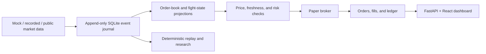

# Octagon · UFC Market Lab

**An event-sourced market-data research platform with deterministic replay and paper execution.**

A Python/FastAPI backend and React/TypeScript dashboard for collecting market observations, maintaining order books, replaying events, applying risk gates, and inspecting simulated orders, positions, and accounting.

## Architecture



## Run the demo

Requires Python 3.12+ and Node.js 20.19+ or 22.12+:

```powershell
git clone https://github.com/Iwetter/UFC-Market-Lab.git
cd UFC-Market-Lab
python start.py
```

The launcher installs dependencies, builds the frontend, and starts the local dashboard at `http://127.0.0.1:8000`. The default source is an explicitly fictional mock scenario and execution is simulated.

## Technical highlights

- Append-only SQLite WAL journal, hash chaining, and source timestamps.
- Order-book sequence checks and explicit invalidation after missing updates.
- Decimal accounting, simulated order arrival, fills, positions, and P&L.
- Recorded-event replay and separate research exports.
- React dashboard for source state, event traces, and paper execution.
- Automated tests for accounting, replay, feed failures, and execution boundaries.

## Status and limitations

This is a research and paper-execution application. It does not bundle a fitted UFC prediction model, historical licensed dataset, or demonstrated profitable strategy. Default probabilities are labeled synthetic; real-data operation requires the documented inputs. The separate live gateway is disabled by default and has no dashboard order route.

Runtime databases, credentials, original prompt/reference archives, and generated frontend assets are excluded from the repository. Review the [technical guide](TECHNICAL_GUIDE.md) and [`docs/implementation.md`](docs/implementation.md) for exact scope and operating assumptions.

```powershell
.venv/Scripts/python -m pytest -q
```

**Tools:** Python · FastAPI · SQLite · React · TypeScript · Vite · pytest

[Ian Hall's engineering portfolio](https://github.com/Iwetter)
