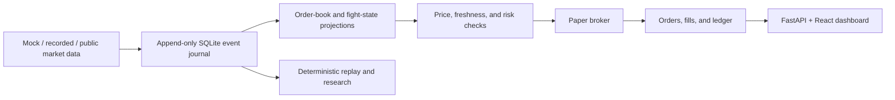

# Octagon · UFC Market Lab

**An event-sourced market-data research platform with deterministic replay and paper execution.**

A Python/FastAPI backend and React/TypeScript dashboard for collecting market observations, maintaining order books, replaying events, applying risk gates, and inspecting simulated orders, positions, and accounting.

## Architecture



## Run the demo

Requires Python 3.12+ and Node.js 20.19+ or 22.12+:

```powershell
git clone https://github.com/Iwetter/UFC-Market-Lab.git
cd UFC-Market-Lab
python start.py
```

The launcher installs dependencies, builds the frontend, and starts the local dashboard at `http://127.0.0.1:8000`. The default source is an explicitly fictional mock scenario and execution is simulated.

## New research and always-on capture

```powershell
.venv/Scripts/python scripts/acquire_mma_data.py --train --artifact-output artifacts/research
.venv/Scripts/python -m backend.recorder --source kalshi --database data/kalshi.sqlite3
```

Open the **Research** tab to inspect actual sample counts, chronological holdout scores, market-reaction hypotheses and the absence of eligible exact-position samples. The live execution models are unchanged until separately validated and explicitly approved. The first command downloads real CC BY 4.0 data at a pinned commit; it never invents exchange prices or publication timestamps.

- [Historical samples, source review and reproduction](docs/data_sources.md) · [actual evaluation report](docs/data-training-report.json)
- [Physical/broadcast timing protocol and 12-second hypothesis](docs/latency-study.md)
- [Mount/back/guard position evidence and its limits](docs/position-data-research.md)
- [Live feed options and optional licensed adapter](docs/live-data-options.md)
- [Always-on Docker/VPS deployment, private access and backups](docs/always-on.md)

For a server with Docker, `docker compose up -d --build` starts the single-writer PAPER recorder and private dashboard. Docker was not available in development; container build and cloud provisioning remain unverified. No server or feed subscription was purchased.

## Automatic experimental PAPER research

Run `python start.py --source kalshi --prepare-data` for public Kalshi data and the fitted historical model. In **Automation**, review the exact bout, canonical fighters, card, settlement rules and earliest start; then enable the deterministic PAPER strategy. It opens/closes simulated YES/NO holdings through the existing latency/depth/fee/risk broker. No real order route is added. Fresh clock observations and every execution gate must pass.

Set `POLYMARKET_US_ENABLED=true` before startup for public US quotes; its optional authenticated markets stream uses separate file-backed credentials. International read-only capture is explicitly opt-in. Polymarket execution remains unfinished.

- [Automatic paper setup and operating limits](docs/autopaper.md)
- [Reproducible Elo/logistic/boosted-tree comparison](docs/ml-pipeline.md) · [actual comparison scores](docs/model-comparison.json)
- [Polymarket official interfaces, configuration and verified capture](docs/polymarket.md)

The selected logistic model scored log loss **0.6573** on 992 reused holdout bouts; the frozen earlier baseline remains slightly better at **0.6560**. Selection uses validation only, followed by a separate calibration window. This reused holdout is not new untouched evidence, and no profitable trading result is claimed.

## Technical highlights

- Append-only SQLite WAL journal, hash chaining, and source timestamps.
- Order-book sequence checks and explicit invalidation after missing updates.
- Decimal accounting, simulated order arrival, fills, positions, and P&L.
- Recorded-event replay and separate research exports.
- React dashboard for source state, event traces, and paper execution.
- Automated tests for accounting, replay, feed failures, and execution boundaries.

## Status and limitations

This is a research and paper-execution application. It now includes fitted historical research baselines, reproducible acquisition of 6,743 bouts and 29,937 judge-round rows, and a real evaluation report. These artifacts are separate from trading-approved models. Default demo probabilities remain labeled synthetic; no profitable strategy or measured 12-second delay is claimed. The separate live gateway is disabled by default and has no dashboard order route.

Runtime databases, credentials, original prompt/reference archives, and generated frontend assets are excluded from the repository. Review the [technical guide](TECHNICAL_GUIDE.md) and [`docs/implementation.md`](docs/implementation.md) for exact scope and operating assumptions.

```powershell
.venv/Scripts/python -m pytest -q
```

**Tools:** Python · FastAPI · SQLite · React · TypeScript · Vite · pytest

[Ian Hall's engineering portfolio](https://github.com/Iwetter)
