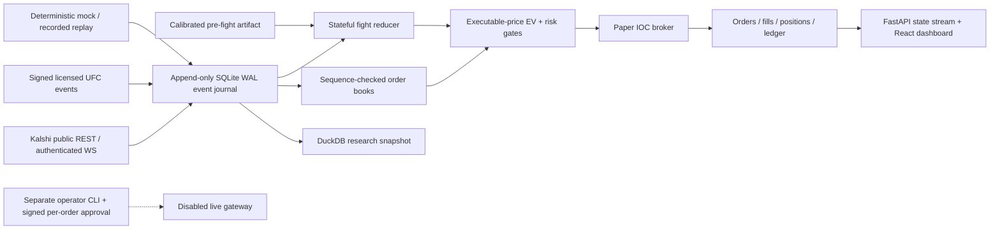

> **October 29 extension:** The original platform guide below describes the initial implementation. Real historical research samples and fitted research-only artifacts are now available; see [data sources](docs/data_sources.md), [evaluation](docs/data-training-report.json), [timing study](docs/latency-study.md), [position evidence](docs/position-data-research.md), and [always-on deployment](docs/always-on.md). New research outputs do not approve the execution models or establish a profitable edge. The original statement that no historical dataset had been supplied refers to the initial build.

# Octagon · UFC Market Lab

A local Python/FastAPI + React platform for UFC probability research, official Kalshi market-data capture, deterministic replay and **PAPER trading**. Persistent accounting and event capture run end to end. No fitted UFC model, historical dataset, profitable strategy or model-performance result is bundled.

The public repository contains the implemented application and technical notes. Original prompt/reference archives and local runtime data are excluded. See `docs/implementation.md` for the exact implemented scope and remaining research work.

## Start with one command

Install Python **3.12+** and Node.js **20.19+ or 22.12+**, including npm. In this folder:

```powershell
python start.py
```

The launcher creates `.venv`, installs pinned Python dependencies, installs the locked npm dependencies, builds the React dashboard, starts the engine on **http://127.0.0.1:8000**, and opens a browser. Internet is required for the first dependency installation. Subsequent launches reuse dependencies. The server binds only to loopback. Ctrl+C stops it.

Default: `source=mock`, `mode=paper`, SQLite database `data/mock.sqlite3`. The fictional Avery North / Blair Vale scenario advances at an accelerated clock. Try an order at the ask plus slippage; inspect its arrival-time fill or cancellation, positions, fills and P&L. Limit prices are dollars (`0.53`), not cents (`53`). A new scenario becomes available when the current one finishes. Pausing the mock also stops its data updates, so freshness gates eventually block trading.

Useful variants:

```powershell
python start.py --source kalshi
python start.py --port 8001 --no-browser
python start.py --source kalshi --model data/prefight.json --infight-model data/infight.json
```

Real and mock sources use separate databases. A database created for one source is rejected by the other. `--database PATH` selects an explicit isolated database. `--no-install` uses the current Python environment and an existing frontend build, for development only.

## Exactly what uses real data

| Component | Default laboratory | `--source kalshi` |
|---|---|---|
| FastAPI, database, audit hashes, ledger | Real implementation | Same implementation |
| Market discovery and books | Synthetic `MOCK-*` contracts | Official public Kalshi REST, `KXUFCFIGHT` |
| Kalshi WebSocket | Not used | Authenticated official market-data WS when read credentials exist; REST polling otherwise |
| Fight feed | Deterministic fictional events | Signed licensed-ingest endpoint; no provider contract or credentials supplied |
| Pre-fight probability | Explicit synthetic prior in demo | Contemporaneous market midpoint until a trained artifact and pre-fight feature snapshot are supplied |
| In-fight probability | Clearly labeled uncalibrated research coefficients | Separate stateful updater; real-market in-fight paper orders require a trained checkpoint artifact |
| Orders, fills, positions and P&L | Simulated | Simulated, using actual observed books |
| Live order gateway | Disabled, separate module/process | Still disabled; dashboard cannot enable or call it |
| Model evaluation | Unit-test fixtures only | Runs only on operator-supplied, licensed point-in-time data |

Smoke-tested against the official public API on **October 21, 2026**: 28 open UFC markets and 28 books; quadratic series fees, multiplier 1; exchange active; zero execution requests. This is an integration observation, not a durable market count or model result. Authenticated WS, licensed vendor streaming and exchange order execution were **not** tested against real accounts because no credentials or license were supplied. Contract tests use explicit test doubles.

## Architecture



`backend/live_gateway.py` is never imported by the engine, app, model or paper broker. There is **no live-order web route**. Strategy/model code has no network execution capability.

SQLite WAL is the transactional single-writer operational/event database. Decimal amounts are serialized as strings, avoiding SQLite REAL rounding. Raw response/frame bytes, receive UTC nanoseconds, process monotonic nanoseconds, source/queue timestamps when present, sequence IDs, session ID and hash chain are retained. SQL triggers prohibit event updates/deletes. Normalized projections are derived. The hash chain is tamper-evident with a trusted root; it is not a substitute for external immutable backups. DuckDB export is separate from the operational writer.

## Kalshi integration and current contracts

Verified against Kalshi's served [OpenAPI](https://docs.kalshi.com/openapi.yaml), [AsyncAPI](https://docs.kalshi.com/asyncapi.yaml), [V2 create-order docs](https://docs.kalshi.com/api-reference/orders/create-order-v2), [order direction](https://docs.kalshi.com/getting_started/order_direction), [WebSocket docs](https://docs.kalshi.com/websockets/websocket-connection), [order-book docs](https://docs.kalshi.com/websockets/orderbook-updates), [API keys](https://docs.kalshi.com/getting_started/api_keys), [fee rounding](https://docs.kalshi.com/getting_started/fee_rounding) and [official fee schedule](https://kalshi.com/docs/kalshi-fee-schedule.pdf). Download hashes are in `docs/api-contract-verification.json`.

- REST production: `https://external-api.kalshi.com/trade-api/v2`.
- Standard WS: `wss://external-api-ws.kalshi.com/trade-api/ws/v2`.
- Demo execution: `https://external-api.demo.kalshi.co/trade-api/v2`.
- Public discovery paginates `/markets?series_ticker=KXUFCFIGHT&status=open` and `/events`; market responses use lifecycle states such as `active` and `finalized`.
- REST uses `orderbook_fp.yes_dollars/no_dollars`. These are bid ladders. YES ask = 1 − best NO bid. WS explicitly requests `use_yes_price: true`; its NO-side levels are converted back to canonical NO-leg bids.
- Any per-subscription sequence discontinuity invalidates every book on that subscription. Buffer-overflow error 25 invalidates affected books. Resync requests `get_snapshot`; reconnection re-subscribes and waits for full snapshots. Public REST remains the fallback when no WS connection exists. An unclocked REST snapshot is never spliced into a running WS delta stream.
- The poller checks top-five levels against REST when no intervening WS clock change was observed. A mismatch invalidates the stream and requests snapshots. Optional WS `clock` is used if supplied; code also supports feeds where it is absent. The fetched docs include future-dated changelog entries; their deployment is not assumed.
- Metadata, series fees, scheduled changes and event-level fee overrides refresh on discovery (60 seconds); `event_fee_update` immediately invalidates fees. Unknown/flat fee types block execution. Price grids come from `price_ranges`, never deprecated `tick_size`.
- GET retry/backoff honors numeric `Retry-After`, caps attempts, and conservatively throttles reads. Writes have **no automatic retry**.
- Ed25519 and RSA-PSS signing use `timestamp + METHOD + path-without-query`. Recorder and order keys use different environment-variable namespaces.

Optional **read-only** WebSocket credentials, in PowerShell:

```powershell
$env:KALSHI_READ_KEY_ID = 'your-read-key-id'
$env:KALSHI_READ_KEY_PATH = 'C:\secure\kalshi-read.pem'
python start.py --source kalshi
```

Use a Kalshi read-only key. Key files stay outside the repository. Public REST needs no key. No keys are bundled. Re-check the wire contract after upstream changes:

```powershell
.venv\Scripts\python scripts/refresh_api_contract.py
```

## Licensed live UFC ingestion

The adapter accepts **canonical cumulative snapshots** supplied by a licensed provider bridge. It does not scrape broadcasts or impersonate a Sportradar integration. Implement the provider-specific mapping against the actual licensed schema and account entitlements; the supplied interface is executable and authenticated, while no provider license or live vendor history is included.

Set `UFC_DATA_LICENSE_ID` to your contract/reference and `UFC_LICENSED_INGEST_SECRET` to a random secret of at least 32 bytes, then start Kalshi mode. POST one JSON `FightEvent` to `/api/ingest/licensed` with:

- `X-Feed-Timestamp`: current UTC epoch milliseconds.
- `X-Feed-Signature`: hex HMAC-SHA256(secret, `timestamp + "." + raw_request_bytes`).

Signatures expire after 60 seconds. Authenticated raw bytes are captured before validation. Never expose this local endpoint publicly without a separately reviewed TLS/authenticated deployment.

Schema example (illustrative, **not a recorded UFC event**):

```json
{
  "bout_id": "your-provider-bout-id",
  "provider_event_id": "your-provider-event-id",
  "kind": "stats",
  "source_ts_ms": 1792620000000,
  "seq": 12,
  "round": 2,
  "clock_remaining": 244,
  "strikes_a": 0, "strikes_b": 0,
  "knockdowns_a": 0, "knockdowns_b": 0,
  "control_a": 0, "control_b": 0,
  "snapshot": true
}
```

Event kinds: `start`, `round_start`, `stats`, `round_end`, `pause`, `resume`, `finish`, `heartbeat`. A finish requires `winner: a|b|draw|nc`. Stats are cumulative, so duplicates never add them twice. Old sequences and duplicate IDs are ignored. A gap blocks use until a full snapshot repairs state. Heartbeats cannot repair missing stats. Round-start anchors retain source wall time and clock. The fight clock is observed, not extrapolated through pauses.

All real-market mappings require explicit human review in the dashboard. Confirm bout ID, common card ID, fighters and YES orientation. Metadata/opponent changes invalidate confirmation. A trained pre-fight prediction must be committed before the feed marks the fight started; its prior is then frozen.

Real mode additionally needs a measured clock observation at least every 60 seconds. A local operator can POST `offset_ms`, `measured_ms`, and `source` to `/api/clock`. The intended source is a real chrony/NTP monitor; this repository does not claim the Windows host is clock-disciplined. Missing/old offsets or absolute offset above 50 ms block orders. The mock's zero offset is explicitly synthetic.

## Model training, calibration and evaluation

No historical UFC observations were supplied. It would be misleading to provide fitted weights or calibrated-performance numbers. The trainable implementation is a regularized symmetric logistic correction to contemporaneous market log odds, with train-only scaling and chronological held-out temperature calibration. The default fallback is the market benchmark. Model artifacts are versioned JSON with hashes, data provenance, cutoff, coefficients, scaling and calibration metrics. They are not executable pickle files.

Prepare a JSON **array** of feature records containing exactly:

| Field | Meaning |
|---|---|
| `event_id`, `bout_id`, `event_date` | Stable IDs and ISO event date; whole cards stay together |
| `decision_ms`, `available_ms` | UTC epoch ms; available ≤ decision |
| `label_available_ms` | Proven result-publication time; strictly after decision |
| `market_probability` | Point-in-time market benchmark, strictly between 0 and 1 |
| `y` | Binary official winner label, separately from exchange settlement |
| `elo_diff`, `age_diff`, `reach_diff`, `layoff_diff`, `strike_rate_diff`, `grapple_rate_diff` | As-of A-minus-B differential features |

Rebuild aggregates from earlier bouts. Do not use current career totals or winner-first listing order. Unknown/future-only columns fail the feature registry. Historical records with unproven availability must be excluded. Cancelled/replaced bouts belong in trading evaluation even when no binary training label exists.

```powershell
.venv\Scripts\python -m backend.research walkforward data/development.json data/walkforward.json --years 2022 2023 2024
.venv\Scripts\python -m backend.research train data/development.json data/prefight.json
.venv\Scripts\python -m backend.research evaluate data/prefight.json data/later-lockbox.json data/lockbox-report.json
python start.py --source kalshi --model data/prefight.json
```

The minimum 30 rows / 5 event dates is a software input guard, **not sufficient evidence of calibration or an edge**. The last 30% of event dates inside training are used for calibration. The fixed regularization specification avoids tuning on outer folds; hyperparameter searches require nested training windows. Walk-forward reports log loss, Brier, ECE, the same-time market benchmark and event-clustered bootstrap intervals for paired log-loss improvement. Keep the lockbox out of development data; the evaluation command requires later decisions and refuses to overwrite an existing report. This is a procedural guard, not protection against an operator deliberately reusing a lockbox.

In-fight training is a separate artifact:

```powershell
.venv\Scripts\python -m backend.research train data/licensed-checkpoints.json data/infight.json --kind infight
```

Use the same metadata plus `strike_diff`, `knockdown_diff`, `control_diff`, `round_score_diff`, `elapsed_fraction` matching `FightState.features()`. Here `market_probability` is the **frozen pre-fight prior**, because the in-fight model estimates evidence conditional on that prior. Do not substitute current market prices. Build one observation per bout/checkpoint; round totals must only become available after publication. Time enters as elapsed fraction times `(2*prior-1)`, preserving exact fighter-swap symmetry. At fight start the engine returns the prior exactly. Default round-score differential remains zero unless an observed score model populates it.

The supplied in-fight implementation is a calibrated-checkpoint logistic updater, an implementable starting alternative. The architecture's trained judge-scorecard enumeration and four-cause finish-hazard model are **not fitted or validated** here. Those require licensed history/scorecards and a separate research milestone.

After loading a pre-fight model, approve its exact hash for **paper** use with `POST /api/models/approve`, then commit a pre-fight prediction via `/api/predictions/prefight` with `ticker`, registered `features`, and `available_ms`. The UI exposes status; OpenAPI at `/docs` describes payloads. Mutations need the same-origin operator token from `/api/session`, in `X-Research-Token`. Approval never authorizes live orders.

## Execution, costs and risk

All dashboard orders are limit IOC paper intents. `id` is a UUID idempotency key: identical retry returns the same order, changed payload under that key is rejected. Paper orders persist as `pending` until configured arrival latency (default 250 ms); the broker re-checks risk and uses the book observed **at processing/arrival**, never the decision midpoint. If processing is late beyond the freshness bound, it cancels. A full fill is `executed`; any unfilled IOC remainder is `canceled`, with `fill_count`, zero `remaining_count` and explicit `canceled_count`. HTTP acceptance is never labeled a fill.

The simulator walks executable asks for buys and bids for sells, adds adverse slippage on the market grid, respects the limit, restricts depth to two smallest grid steps from touch and takes at most 25% of displayed size at each level. It tracks simulated consumption within a book update. It does not establish queue priority or reproduce counterfactual market impact. No maker order support is advertised in this implementation; the API rejects unsupported time-in-force/order forms.

EV is settlement-held `q*(p - executable_ask - slippage) - fee_upper_bound`. The dashboard displays one-contract EV at the ask. Its indicative multi-contract fee is conservatively scaled from this amount; actual fills use a per-order accumulator. Money and counts use Decimal; probabilities/statistical inference may use floating point. General taker rate is 0.07 times current multiplier and `q*p*(1-p)`. Current quadratic maker structures are supported by the fee calculator, although maker execution is not enabled. Each fill rounds trade fees to $0.000001, aligns the cash movement to the member precision (default non-direct member $0.01) and carries/rebates overpayment across that order's fills. Unknown fee structures fail closed.

The ledger includes fees, cash, reserved pending capital, remaining cost basis, realized P&L and unrealized P&L marked at executable bids **before potential exit fees**. Sells reduce existing holdings only; there is no shorting or margin. Finalized **Kalshi settlement values**, including fractional fair values, settle real-data paper positions; a feed's official fight result alone cannot settle them. Provisional/determined results do not pay out. Settlement is idempotent.

Risk checks include mapping confirmation/replacements, market status and close time, exchange availability, book and fight freshness, sequence health, clock discipline, model approval, supported fees, price grid, whole-contract restriction where fractional support is unknown, spread, order/bout/card/total exposure, daily spend budget, available cash, opposite orders/positions, reduce-only holdings and round-end blackout. Defaults are in `config/default.json`. A $20 peak-to-current daily drawdown or $25 daily loss triggers kill. Three distinct data-failing intents trip a circuit breaker; idempotent retries do not increment it. Probability divergence above 0.35 or extreme live-model outputs also trigger kill. Resetting the paper kill switch is an explicit local action; breached limits still apply.

## Recorded replay and warehouse export

```powershell
.venv\Scripts\python -m backend.research replay data/mock.sqlite3 data/replay-001.sqlite3
.venv\Scripts\python -m backend.research replay data/kalshi.sqlite3 data/replay-002.sqlite3 --source kalshi --session SESSION_ID --model data/prefight.json --infight-model data/infight.json --fight-delay-ms 5000
.venv\Scripts\python -m backend.research export data/kalshi.sqlite3 data/research.duckdb
```

Replay outputs must be new, isolated databases. Replay reads normalized capture events into the same engine, risk checks, fee model and paper broker; it does not re-fetch prices. The manifest includes code, config and input hashes, and the output has a deterministic hash. It records execution ticks to reproduce the observed paper processing time. Model artifacts and approvals must match the recording. Per-source latency stress reorders availability, never source event time. One recording process/session can be replayed directly; cross-session/host merges are rejected until an explicitly clock-synchronized merge is prepared. Replaying only a later session without its starting state is not equivalent to a complete run.

This is receive-order **recorded-stream replay**, not an unconstrained historical simulator. Kalshi does not supply historical order-book depth through the integrated public endpoints. No fictitious depth is reconstructed from candles. Exact queue simulation, stochastic order latency, oracle runs and maker sensitivity studies remain research extensions.

## Optional isolated order gateway

The normal application schema rejects `live_enabled=true`. There is no setting in the dashboard that can submit real orders. A separate operator-only CLI exists for reviewed API plumbing; **no real or demo orders were sent during development**.

`config/live.example.json` has both `enabled=false` and `production_enabled=false`. Opting in requires editing a separate local config, a dedicated flat account/audit database (unrelated positions fail reconciliation), an order key in `KALSHI_ORDER_KEY_ID` / `KALSHI_ORDER_KEY_PATH`, and a random `UFC_LIVE_APPROVAL_SECRET` of at least 32 bytes. Production additionally requires `production_enabled=true`, `KALSHI_ENV=prod` and `--production`; otherwise the host is the official demo environment. Use separate demo/production databases. A live key must never be assigned to the recorder variables.

For an operator who has deliberately configured the **demo** gateway:

```powershell
.venv\Scripts\python -m backend.live_gateway arm --config data/my-demo-config.json
.venv\Scripts\python -m backend.live_gateway submit --config data/my-demo-config.json --intent data/reviewed-intent.json
.venv\Scripts\python -m backend.live_gateway kill --config data/my-demo-config.json
```

Arming requires typed confirmation and expires after one hour (hard maximum four hours). Each submit displays environment, ticker, outcome, YES-leg price, count, fee, worst-case loss and model/market prices, then requires the exact UUID-specific typed confirmation. Its signed approval binds the exact intent, session and fresh review and lasts 60 seconds; review state is at most five seconds old. Long human deliberation requires a refreshed review. There is no batch/auto-approval. Orders are capped at 2 contracts, sessions at $10 by default and $25 hard maximum, and the series is restricted to KXUFCFIGHT.

The gateway checks exchange lifecycle/grid and its dedicated ledger before submission. V2 wire payloads use `bid`/`ask`, `count`, YES-leg `price`, `client_order_id=intent UUID`, IOC, self-trade prevention, cancel-on-pause and a contract-limited order group; exits use reduce-only. Unknown acknowledgements persist as `unknown` **before** the network call, revoke arming and are never blindly retried. Duplicate intent IDs return the recorded state. An unresolved submission blocks new ones.

The single-order CLI remains in a 30-second fills/positions reconciliation loop and revokes/cancels on mismatch or expiry. Exiting it revokes the session. Kill revokes locally before sending cancel-all. IOC orders never rest. Reconciliation deliberately refuses unexplained external positions, incomplete pagination/history, settlement-driven discrepancies and unresolved submissions; manual investigation/new audited state is required. It is a guarded research adapter, not certified production trading infrastructure. The software does not determine account eligibility or license permissions.

## Tests and operational checks

After startup has installed dependencies:

```powershell
.venv\Scripts\python scripts/check.py
.venv\Scripts\python scripts/scan_secrets.py
```

The check script runs Python tests, frontend tests and TypeScript/production build. It uses workspace-local temporary directories. CI runs the same checks on Windows and Linux, Python 3.12/3.13. Tests use only test doubles/synthetic **unit-test fixtures**, not invented research results. Live network integration is an explicit smoke check, not a dependency of the offline suite. See `docs/verification.md` for actual milestone checks and known untested systems.

Dashboard tabs: Workspace, Markets, Models and Audit. `/api/state`, `/api/audit`, `/api/health`, `/metrics` and `/docs` provide read-only inspection; `/ws` streams state and automatically reconnects in the UI. Mutations require a local random session token, same-origin checking and trusted Host validation. Credentials are never returned to the browser. There are no third-party telemetry calls or remote frontend assets.

Back up the SQLite database with SQLite's backup API or a consistent WAL-aware snapshot. Do not copy only the main file while writes are active. Raw SQLite events and ledger should be retained; DuckDB research snapshots are reproducible exports. Protect local files and separate paper/replay/live databases.

No data licenses, market eligibility, sustained card-level uptime, measured information lead, out-of-sample model calibration or trading edge are implied by passing software tests. Those require the data collection and forward research described in the attached architecture.
